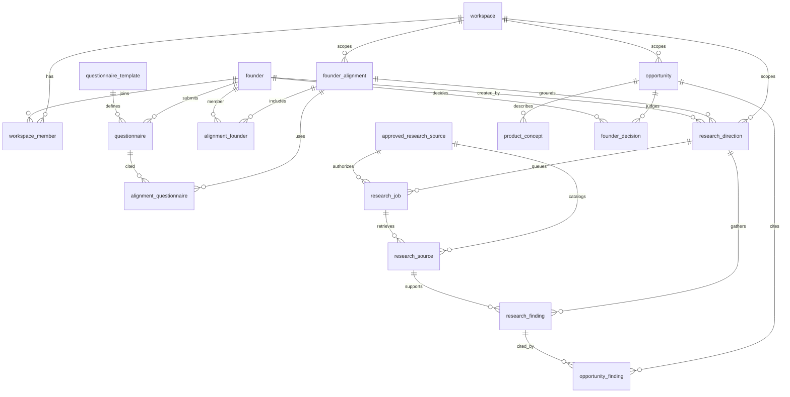

# Database design

This is the target relational design for the foundation. It explains why the tables, keys, and constraints are shaped this way, so a later Flyway migration can implement them without re-deciding the domain. Column lists below are illustrative. They are not a migration, and nothing in this document has been applied to a database.

The schema is PostgreSQL, changed only through Flyway, with UUID primary keys, foreign keys, indexes, and transactions. Interactive rows that two sessions can save at the same time carry an integer `version` column mapped to JPA `@Version`.

Related documents:

- [Architecture decisions](ARCHITECTURE_DECISIONS.md) record why the stack and boundaries exist.
- [API contracts](../api/API_CONTRACTS.md) are the HTTP surface over these tables.
- [Research pipeline](../ai/RESEARCH_PIPELINE.md) is how jobs, retrievals, and findings are produced.
- [Implementation plan](../development/IMPLEMENTATION_PLAN.md) sequences the work. Opportunity, product concept, and founder decision tables are part of this foundation schema because the domain model is part of the foundation. Their APIs and screens wait for phase 6.

## Why one schema for the whole domain

The product is one workspace of founders. They answer a changing questionnaire, build an alignment, run research only against a catalogued source, and keep findings that cite a real retrieval. Opportunities cite those findings. Product concepts describe an opportunity. Founder decisions accumulate so a later choice does not erase an earlier one.

Those steps are one model. Splitting opportunities, concepts, and decisions into a later schema would leave findings with nowhere honest to land, and it would invite a second design once phase 6 starts. Flyway creates the full foundation model up front. Phase 6 is when the application exposes opportunity, product, and decision APIs and screens. Until then the tables exist so the rest of the model can reference them, and so provenance rules are real foreign keys from the first migration.

PostgreSQL is the engine because the design needs transactional inserts (a finding with its retrieval, an alignment with its members), JSON documents whose shape will change during discovery, and `FOR UPDATE SKIP LOCKED` so the research poller can claim work. Flyway is the history of that schema. This file is the design that history should follow.

UUID primary keys let the application identify a row when the request starts, including an idempotent research job, without taking a global sequence lock. UUIDs do not replace natural uniqueness: email, template `version_number`, and `(direction_id, idempotency_key)` stay unique on their own. Entity tables use a UUID `id`. Join tables whose only identity is a pair use that pair as the primary key. A surrogate id on a pair would still need the unique pair, so the pair is the key.

Every foreign key is indexed. PostgreSQL does not index the referencing column of a foreign key, and a parent delete or a "rows for this founder" query would otherwise scan the child table.

Allowed status and category values are `text` plus a `CHECK` constraint. The check makes an illegal status fail in the database. A later allowed value is a Flyway change to that check. The closed lists are part of the design and are restated on each table below.

## One workspace, founders as members

The current product is three founders in one venture. That is seed data, not three physical tables.

`workspace` is the boundary for alignment, research directions, and opportunities. The migration that implements this design inserts one workspace row. All three founders attach to that row. A fourth founder, or a second workspace, is more rows. It is not a new table per person and not a fork of the schema.

`founder` is a person: name, unique email, and a `profile` document. `workspace_member` is the membership. Role is data. The only role this design allows is `FOUNDER`. Putting role on the membership row means a later role is a constraint change, not a new user table. The unique pair `(workspace_id, founder_id)` means a person joins a workspace once.

Email is unique on `founder`, not on the membership. Identity is the person. Membership is how that person relates to the workspace. Questionnaires, research directions (`created_by`), and decisions all point at `founder`, so accountability stays on a person even when the work product belongs to the workspace.

`profile` is `jsonb` because the attributes worth keeping (skills, background, constraints) will change while the founders are still discovering how they describe themselves. Those attributes are not stable enough to be columns. The application owns the document shape.

### `workspace`

| Column | Type | Notes |
| --- | --- | --- |
| `id` | `uuid` | Primary key |
| `name` | `text` | Required |
| `created_at` | `timestamptz` | Required |

Seed: one row, shared by the three founders through `workspace_member`.

### `founder`

| Column | Type | Notes |
| --- | --- | --- |
| `id` | `uuid` | Primary key |
| `name` | `text` | Required |
| `email` | `text` | Required, unique |
| `profile` | `jsonb` | Required; shape owned by the application |
| `created_at` | `timestamptz` | Required |
| `updated_at` | `timestamptz` | Required |
| `version` | `integer` | Required. JPA `@Version`, starts at 0 |

`version` is optimistic locking. Two sessions saving the same founder must not silently overwrite each other. JPA increments `version` on flush. An update that still holds the caller's old version changes zero rows, and the caller reloads.

### `workspace_member`

| Column | Type | Notes |
| --- | --- | --- |
| `workspace_id` | `uuid` | Primary key, foreign key to `workspace` |
| `founder_id` | `uuid` | Primary key, foreign key to `founder` |
| `role` | `text` | Required. Check: `FOUNDER` |

Primary key `(workspace_id, founder_id)`.

## Business type is data

`opportunity.business_type` and `product_concept.business_type` are columns with a default of `PHYSICAL_PRODUCT`. Allowed values are `PHYSICAL_PRODUCT`, `SERVICE`, `SOFTWARE`, and `OTHER`.

The venture currently assumes a physical product, so an insert that omits the column still records that assumption. A service, software, or other venture is a different value in the same column. It does not need its own opportunity table, product table, or API resource. Both tables carry the column because a concept can explore the same customer problem under a different type than the opportunity it belongs to, and that difference is data.

`estimated_costs` and `feasibility` on `product_concept` are `text` for the same reason the type is a label: early estimates are ranges and caveats. A numeric cost model would pretend the founders already have a ledger.

## Relationship map

Foreign-key cardinality is what the diagram shows. It does not draw the service rule that an alignment includes at least two founders. That rule is stated with `founder_alignment`.



## Questionnaires stay interpretable when questions change

Questions live on `questionnaire_template`, not as columns and not only inside a submission. Each published question set is one row: a unique `version_number` and a `definition` document. A new question set is a new row. `version_number` is the published revision. It is not JPA `@Version`, and the template table has no `updated_at`, because a published definition is insert-only. The service writes a new template when the questions change. Editing a published definition in place would change the meaning of every submission that points at it.

`definition` is `jsonb` because a version is one atomic question set (prompts, ids, and answer shapes). Readers load that set in one row. The application owns the JSON shape so discovery can rewrite questions without a column migration.

### `questionnaire_template`

| Column | Type | Notes |
| --- | --- | --- |
| `id` | `uuid` | Primary key |
| `version_number` | `integer` | Required, unique |
| `definition` | `jsonb` | Required question set |
| `created_at` | `timestamptz` | Required |

### `questionnaire`

| Column | Type | Notes |
| --- | --- | --- |
| `id` | `uuid` | Primary key |
| `founder_id` | `uuid` | Required, foreign key to `founder` |
| `template_id` | `uuid` | Required, foreign key to `questionnaire_template` |
| `status` | `text` | Required. Check: `DRAFT`, `SUBMITTED` |
| `answers` | `jsonb` | Required snapshot |
| `submitted_at` | `timestamptz` | Null while `DRAFT` |
| `created_at` | `timestamptz` | Required |
| `updated_at` | `timestamptz` | Required |
| `version` | `integer` | Required. JPA `@Version` |

`answers` is a `jsonb` snapshot, and `template_id` points at the question set that explains the keys. Both are required.

The question set will change during discovery. A snapshot preserves what the founder actually submitted. `template_id` preserves which definition those keys belonged to. Alignment and later readers use that pair, so a newer template does not reinterpret an older submission.

A fully normalized answer table (one row per question, foreign key to a live question row) would make a historical submission depend on question rows that discovery is about to rewrite, split, or remove. Keeping every past question immutable can preserve history, but only if nobody reuses a question id for a reworded prompt, and only by reconstructing the submission from many rows. The snapshot is the submission as one value, taken at submit time. The template row remains the interpreter. That is the right trade while the question set is still moving: fewer joins, no silent rebinding of old answers to new wording, and a template history that stays readable because templates are versioned by insert.

`DRAFT` rows are editable. Concurrent drafts use `version` so two saves cannot clobber each other. On submit, the service sets `status` to `SUBMITTED`, writes `submitted_at`, and keeps the `answers` document that was submitted. Alignment links questionnaires that have been submitted, because a draft is not yet the snapshot the alignment was computed from.

## Alignment

An alignment is a workspace artifact: shared interests, complementary skills, and a prose explanation. It becomes `READY` only after the service has written those fields from submitted questionnaires. `shared_interests` and `complementary_skills` are `jsonb` because their item shape will change during discovery, the same way questions will. The database stores the documents; it does not interpret them. `ai_explanation` is `text` because founders read it as prose.

`workspace_id` is denormalized onto the alignment on purpose. Workspace is the authorization boundary, so listing alignments does not require guessing the tenant from the members. The service writes members who belong to that same workspace.

### `founder_alignment`

| Column | Type | Notes |
| --- | --- | --- |
| `id` | `uuid` | Primary key |
| `workspace_id` | `uuid` | Required, foreign key to `workspace` |
| `status` | `text` | Required. Check: `DRAFT`, `READY` |
| `shared_interests` | `jsonb` | Required document |
| `complementary_skills` | `jsonb` | Required document |
| `ai_explanation` | `text` | Required; may be empty while `DRAFT` |
| `created_at` | `timestamptz` | Required |

### `alignment_founder`

| Column | Type | Notes |
| --- | --- | --- |
| `alignment_id` | `uuid` | Primary key, foreign key to `founder_alignment` |
| `founder_id` | `uuid` | Primary key, foreign key to `founder` |

Primary key `(alignment_id, founder_id)`.

The application rule is at least two distinct founders. The service is the enforcer of that minimum. In one transaction it inserts the `founder_alignment` row and at least two `alignment_founder` rows. The join table prevents duplicates: the same founder cannot be attached to the same alignment twice, which is what "distinct" means at the key.

A minimum count is a poor fit for an ordinary row check. The alignment row has to exist before its member rows, so a non-deferrable check on `founder_alignment` cannot see the members yet. A deferrable constraint, or a trigger that runs at commit and rejects an alignment with fewer than two `alignment_founder` rows, is optional and is worth adding when it stays simple. Until that exists, the service transaction is the rule. A SQL comment is not the control.

### `alignment_questionnaire`

| Column | Type | Notes |
| --- | --- | --- |
| `alignment_id` | `uuid` | Primary key, foreign key to `founder_alignment` |
| `questionnaire_id` | `uuid` | Primary key, foreign key to `questionnaire` |

Primary key `(alignment_id, questionnaire_id)`.

The pair records which submitted snapshots the alignment used. A later template, or a later questionnaire, does not change an alignment that has already been computed. The unique pair prevents the same snapshot from being attached twice.

## Research directions

A direction is a line of inquiry inside a workspace, grounded in an alignment. `origin` records who put it there: `AI`, `FOUNDER`, or `EXTERNAL`. `created_by` is always a founder, including when `origin` is `AI`, so a person remains accountable for keeping the direction. `workspace_id` matches the alignment's workspace; the service writes them as the same workspace so directory queries and authorization do not depend on a join. `version` covers concurrent edits to title, description, and status.

### `research_direction`

| Column | Type | Notes |
| --- | --- | --- |
| `id` | `uuid` | Primary key |
| `workspace_id` | `uuid` | Required, foreign key to `workspace` |
| `alignment_id` | `uuid` | Required, foreign key to `founder_alignment` |
| `title` | `text` | Required |
| `description` | `text` | Required |
| `origin` | `text` | Required. Check: `AI`, `FOUNDER`, `EXTERNAL` |
| `status` | `text` | Required. Check: `DRAFT`, `ACTIVE`, `ARCHIVED` |
| `created_by` | `uuid` | Required, foreign key to `founder` |
| `created_at` | `timestamptz` | Required |
| `updated_at` | `timestamptz` | Required |
| `version` | `integer` | Required. JPA `@Version` |

## Approved sources and retrievals

The worker may call only catalogued sources. `approved_research_source` is the catalog. `research_source` is one retrieval. The names are deliberately different so a URL the adapter happened to call is never treated as permission to call it again.

The catalog row holds the human name, the adapter key (`source_type`), the `base_url` the worker is allowed to use, and notes. The job points at that row. `source_config` on the job holds parameters for that adapter (dataset, year, geography, industry). It does not hold a license to pick a host. The service builds the request from the catalog `base_url` plus those parameters, and it rejects a config that tries to override the endpoint. The foreign key is what stops a job from naming an unknown source. The service rule is what stops a parameter document from smuggling in a different URL.

Seed one catalog row (in the migration that implements this design, not by this file):

| Column | Seed |
| --- | --- |
| `name` | `US Census County Business Patterns` |
| `base_url` | `https://api.census.gov/data/` |
| `source_type` | The adapter key the worker selects for this catalog row |
| `notes` | County Business Patterns describes establishment structure. It does not establish customer pain |

### `approved_research_source`

| Column | Type | Notes |
| --- | --- | --- |
| `id` | `uuid` | Primary key |
| `name` | `text` | Required |
| `source_type` | `text` | Required adapter key |
| `base_url` | `text` | Required |
| `notes` | `text` | Required; may be empty |

### `research_job`

| Column | Type | Notes |
| --- | --- | --- |
| `id` | `uuid` | Primary key |
| `direction_id` | `uuid` | Required, foreign key to `research_direction` |
| `approved_research_source_id` | `uuid` | Required, foreign key to `approved_research_source` |
| `status` | `text` | Required. Check: `PENDING`, `RUNNING`, `SUCCEEDED`, `FAILED`, `CANCELLED` |
| `source_config` | `jsonb` | Required parameters for the catalogued adapter |
| `started_at` | `timestamptz` | Null until claimed |
| `completed_at` | `timestamptz` | Null until a terminal status |
| `error` | `text` | Null unless the run records a failure or cancellation |
| `token_usage` | `integer` | Null when the run never reached a model call |
| `estimated_cost` | `numeric` | Null when there is no estimate; `numeric` so money is not binary floating point |
| `attempt_count` | `integer` | Required |
| `idempotency_key` | `text` | Required |
| `created_at` | `timestamptz` | Required |
| `version` | `integer` | Required integer |

Unique `(direction_id, idempotency_key)`. A retry of the same logical run on the same direction returns the existing job. The same key on a different direction is different work, which is why the unique constraint includes `direction_id`.

`token_usage` and `estimated_cost` are nullable because a job can fail before any model call, and a Census retrieval by itself may have no token cost. When a run does spend model usage, the cost is stored on the job that incurred it.

`version` on the job is the integer used when status is written back. It is not the poller's lock, and it is not one of the four JPA `@Version` mappings (those are `founder`, `questionnaire`, `research_direction`, and `opportunity`). A cancel from a request and a completion from a worker can race. The writer includes the version it read, so a stale `SUCCEEDED` update does not overwrite `CANCELLED`.

Claiming work is application SQL in the worker transaction, not a lock table:

```sql
SELECT id
FROM research_job
WHERE status = 'PENDING'
ORDER BY created_at
FOR UPDATE SKIP LOCKED
LIMIT $1;
```

The same transaction sets `status` to `RUNNING`, sets `started_at`, and increments `attempt_count`. `SKIP LOCKED` lets a second poller take the next free `PENDING` row. Status on `research_job` is the queue. A lock table would be a second source of truth that can say "locked" while status still says `PENDING`, or `RUNNING` with the lock already gone. The row lock lasts for the claim transaction. It is not a table anyone migrates.

### `research_source`

| Column | Type | Notes |
| --- | --- | --- |
| `id` | `uuid` | Primary key |
| `approved_research_source_id` | `uuid` | Required, foreign key to `approved_research_source` |
| `research_job_id` | `uuid` | Required, foreign key to `research_job` |
| `request` | `jsonb` | Required. The request that was sent |
| `original_reference` | `text` | Required citation (URL, dataset, vintage) |
| `payload_hash` | `text` | Required fingerprint of the retrieved body |
| `retrieved_at` | `timestamptz` | Required |

This row is one retrieval the adapter persisted, not a catalog entry. A job may persist more than one retrieval (a paged response, a second variable set). `request` is what was asked. `original_reference` is what a founder can cite. `payload_hash` binds the row to a specific response body. This design does not add a payload column on the retrieval: findings must stay readable beside a citation, and the pipeline document owns how response bytes are stored. The hash is the relational anchor so a finding cites that retrieval and not "the Census" in general.

The catalog foreign key on the retrieval records which approved source the call used. It does not by itself authorize anything. Authorization happened when the job was created against the catalog.

## Findings cite a persisted retrieval

A finding cannot exist without a source row the adapter persisted. `research_source_id` is `NOT NULL` and a foreign key, so the insert fails if the retrieval is missing. The worker inserts `research_source` and `research_finding` in one transaction. The catalog row is not a substitute: the finding points at the retrieval, and the retrieval points at the catalog.

`direction_id` is also required so a direction can list its findings without reconstructing them through jobs. The service writes `research_finding.direction_id` equal to `research_job.direction_id` of the cited retrieval. A trigger can enforce that equality later. The service is responsible for writing the two direction ids as the same direction. The database, unconditionally, enforces that the source row exists.

There is no confidence column. A number there would be read as a probability that the customer problem is real. County Business Patterns does not produce that probability. `verification_status` is a later human judgment, defaulting to `UNREVIEWED`, and then `CONFIRMED` or `REJECTED`. Those words are judgments. They are not a model score.

Census counts are establishment structure (how many establishments, of what size, in what industry and geography). They are not proof of customer pain. The finding keeps those ideas in separate columns so a count cannot be laundered into demand:

- `factual_summary` is what the retrieval supports.
- `supporting_evidence` is the quoted figures or passage the summary rests on.
- `ai_interpretation` is the model's reading, which a founder can discard without losing the summary.
- `unknowns` is where the limit is written, including that an establishment count does not show a customer problem, willingness to pay, or pain.

`updated_at` exists because verification status changes after the worker inserts the row. Findings are not in the `@Version` set. The grounding rule is the non-null source foreign key.

### `research_finding`

| Column | Type | Notes |
| --- | --- | --- |
| `id` | `uuid` | Primary key |
| `direction_id` | `uuid` | Required, foreign key to `research_direction` |
| `research_source_id` | `uuid` | Required, not null, foreign key to `research_source` |
| `factual_summary` | `text` | Required |
| `supporting_evidence` | `text` | Required |
| `ai_interpretation` | `text` | Required |
| `unknowns` | `text` | Required |
| `verification_status` | `text` | Required. Check: `UNREVIEWED`, `CONFIRMED`, `REJECTED`. Default `UNREVIEWED` |
| `created_at` | `timestamptz` | Required |
| `updated_at` | `timestamptz` | Required |

## Opportunities, concepts, and decisions

These tables are foundation schema. Phase 6 is the API and screen work that lets founders use them. The columns exist now so a finding can be cited, a concept can describe an opportunity, and a decision can be stored as history.

`opportunity.status` is the lifecycle of the opportunity (`DRAFT`, `UNDER_REVIEW`, `ADVANCED`, `ARCHIVED`). That is separate from each founder's decision. Founders can disagree, and the opportunity still has one lifecycle. `evaluation_summary` is the workspace's current prose summary. `version` guards concurrent edits. `workspace_id` is the same authorization boundary as on directions. Cited findings belong to directions in that workspace; the service checks that when it writes `opportunity_finding`.

### `opportunity`

| Column | Type | Notes |
| --- | --- | --- |
| `id` | `uuid` | Primary key |
| `workspace_id` | `uuid` | Required, foreign key to `workspace` |
| `title` | `text` | Required |
| `customer_problem` | `text` | Required |
| `target_customer` | `text` | Required |
| `status` | `text` | Required. Check: `DRAFT`, `UNDER_REVIEW`, `ADVANCED`, `ARCHIVED` |
| `evaluation_summary` | `text` | Required |
| `business_type` | `text` | Required. Check: `PHYSICAL_PRODUCT`, `SERVICE`, `SOFTWARE`, `OTHER`. Default `PHYSICAL_PRODUCT` |
| `created_at` | `timestamptz` | Required |
| `updated_at` | `timestamptz` | Required |
| `version` | `integer` | Required. JPA `@Version` |

### `opportunity_finding`

| Column | Type | Notes |
| --- | --- | --- |
| `opportunity_id` | `uuid` | Primary key, foreign key to `opportunity` |
| `research_finding_id` | `uuid` | Primary key, foreign key to `research_finding` |

Primary key `(opportunity_id, research_finding_id)`.

The opportunity cites findings. It does not copy their summary, evidence, interpretation, or unknowns. If a finding is later `REJECTED`, the citation remains and the evaluation can be reconsidered against the original wording. The unique pair prevents citing the same finding twice.

### `product_concept`

| Column | Type | Notes |
| --- | --- | --- |
| `id` | `uuid` | Primary key |
| `opportunity_id` | `uuid` | Required, foreign key to `opportunity` |
| `description` | `text` | Required |
| `target_buyers` | `text` | Required |
| `differentiation` | `text` | Required |
| `estimated_costs` | `text` | Required |
| `feasibility` | `text` | Required |
| `business_type` | `text` | Required. Same check and default as `opportunity.business_type` |
| `created_at` | `timestamptz` | Required |
| `updated_at` | `timestamptz` | Required |

Many concepts can belong to one opportunity. A redesign can be a new row, so the earlier description is still there. Concepts are editable (`updated_at`). The judgment about a concept is not stored by overwriting the concept. It is stored as a founder decision.

### `founder_decision`

| Column | Type | Notes |
| --- | --- | --- |
| `id` | `uuid` | Primary key |
| `opportunity_id` | `uuid` | Required, foreign key to `opportunity` |
| `founder_id` | `uuid` | Required, foreign key to `founder` |
| `decision` | `text` | Required. Check: `ADVANCE`, `INVESTIGATE`, `REDESIGN`, `ARCHIVE` |
| `rationale` | `text` | Required |
| `created_at` | `timestamptz` | Required |

Decisions are append-only. The service inserts a row. It does not update or delete one. There is no `updated_at` and no `version`, because those columns exist to support mutation.

Founders must be able to see that a decision changed. If a founder moves from `INVESTIGATE` to `ADVANCE`, or to `ARCHIVE`, both rationales have to remain. An in-place update would leave only the latest word and hide the change. History is the record of the change.

The latest decision per founder is a query, ordered by `created_at`. For one opportunity, each founder's current decision is the row with that `founder_id` and the greatest `created_at`. The full history is every row for that `opportunity_id` in `created_at` order. Disagreement is visible because each founder has their own rows.

```sql
SELECT DISTINCT ON (founder_id) *
FROM founder_decision
WHERE opportunity_id = $1
ORDER BY founder_id, created_at DESC;
```

That statement is the application read. It is not a migration.

## Referential actions

Historical rows are `ON DELETE RESTRICT`: questionnaires, alignments that already have directions, jobs, retrievals, findings, opportunities, concepts, and decisions. Deleting a founder, a source, or a finding must not silently remove the record that explained a decision. Cascade would look like integrity while destroying the chain the schema exists to keep.

Pure membership pairs can cascade when their parent aggregate is removed: `workspace_member`, `alignment_founder`, `alignment_questionnaire`, and `opportunity_finding`. Those rows have no meaning without the pair, and they do not carry the evidence text. A direction that still points at an alignment restricts deletion of that alignment.

`research_finding.research_source_id` restricts deletion of a retrieval that findings cite. That is the same grounding rule as `NOT NULL`: a finding is not allowed to outlive its source.

## Indexes

Unique and primary-key constraints already create indexes. The extra indexes below exist because PostgreSQL will not create them from the foreign keys, and because a few reads dominate.

| Index | Why |
| --- | --- |
| Unique `founder (email)` | One person, one identity. Membership does not dedupe people |
| Unique `questionnaire_template (version_number)` | One published question set per revision |
| Unique `workspace_member (workspace_id, founder_id)` | A founder joins a workspace once. Also serves lookups by workspace |
| `workspace_member (founder_id)` | Memberships for a person. The pair index does not lead with `founder_id` |
| `questionnaire (founder_id)` | A founder's drafts and submissions |
| `questionnaire (template_id)` | Submissions of one question set |
| `founder_alignment (workspace_id)` | Alignments in the workspace |
| Unique `alignment_founder (alignment_id, founder_id)` | Distinct founders on an alignment |
| `alignment_founder (founder_id)` | Alignments that include a person |
| Unique `alignment_questionnaire (alignment_id, questionnaire_id)` | A snapshot is attached once |
| `alignment_questionnaire (questionnaire_id)` | Alignments that used a submission |
| `research_direction (workspace_id)` | Directions in the workspace |
| `research_direction (alignment_id)` | Directions grounded in an alignment |
| `research_direction (created_by)` | Directions a founder created |
| Unique `research_job (direction_id, idempotency_key)` | Retry identity. Also serves jobs for a direction |
| `research_job (approved_research_source_id)` | Jobs that used a catalog entry |
| Partial `research_job (created_at) WHERE status = 'PENDING'` | The poller claims pending work in creation order. Terminal rows are most of the table, so the partial index stays small. Status is the queue the poller reads |
| `research_source (research_job_id)` | Retrievals for a job |
| `research_source (approved_research_source_id)` | Retrievals under a catalog entry |
| `research_finding (direction_id)` | Findings for a direction, the primary review path |
| `research_finding (research_source_id)` | Findings that cite a retrieval, and restricted deletes of that retrieval |
| `opportunity (workspace_id)` | Opportunities in the workspace |
| Unique `opportunity_finding (opportunity_id, research_finding_id)` | A finding is cited once |
| `opportunity_finding (research_finding_id)` | Opportunities that cite a finding |
| `product_concept (opportunity_id)` | Concepts for an opportunity |
| `founder_decision (opportunity_id, founder_id, created_at)` | History for an opportunity in time order, and the latest decision per founder. `opportunity_id` plus `created_at` is the access path; `founder_id` keeps each founder's rows contiguous |
| `founder_decision (founder_id)` | Decisions recorded by a person |

The poller index is on status because the claim query filters `PENDING`. It is not a lock table. `FOR UPDATE SKIP LOCKED` is the lock, held by the worker transaction described above.

## Transactions

Each of these commits together, or not at all:

- An alignment with its `alignment_founder` rows (at least two) and its `alignment_questionnaire` rows. A one-founder alignment must not be visible.
- A questionnaire submit: `answers`, `status`, `submitted_at`, and the incremented `version`, conditioned on the caller's version.
- A job claim: the `FOR UPDATE SKIP LOCKED` select and the update to `RUNNING`.
- A retrieval and the findings that cite it. The finding insert follows the source insert in the same transaction, so the foreign key never has to be deferred for the grounding rule.
- A founder decision: a single insert.

Optimistic locking on `founder`, `questionnaire`, `research_direction`, and `opportunity` is the JPA `@Version` column. The update predicate includes the version the client read. Zero rows means the client reloads and retries from the current values. That covers interactive documents. It does not claim the research queue. The queue claim is the row lock above, because two pollers that both read `PENDING` and then both check a version would still both try to run the job. `SKIP LOCKED` makes the second poller take a different row.

## What the database enforces, and what the service enforces

The database enforces:

- Primary keys, unique email, unique template `version_number`, unique membership, unique alignment pairs, unique opportunity-finding pairs, and unique `(direction_id, idempotency_key)`.
- Foreign keys, including `research_finding.research_source_id` not null, so a finding cannot be stored without a retrieval row.
- Check constraints for the allowed values listed on each table.
- The partial index and the job status values the poller depends on. The lock itself is application SQL.

The service enforces:

- At least two distinct founders on an alignment, in one transaction. The join table enforces distinctness. An optional deferrable constraint or commit-time trigger may also enforce the minimum. The service remains the enforcer named by this design.
- Submitted questionnaires as the only snapshots linked from an alignment.
- Insert-only questionnaire templates, and append-only founder decisions.
- Jobs only against `approved_research_source`, with `source_config` unable to replace `base_url`.
- `research_finding.direction_id` equal to the direction of the retrieval's job, and opportunity citations that stay inside the opportunity's workspace.
- Worker calls only to catalogued sources, as the pipeline describes.

Phase 6 implements the opportunity, product concept, and decision APIs and screens on top of tables this foundation already includes. See the implementation plan.
