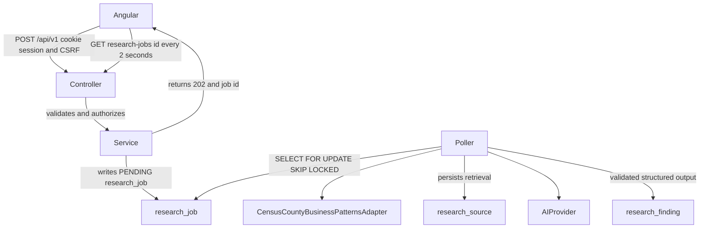

# Target architecture

This document describes the architecture to build for Founders. It is a decision record, not a description of running software.

The audit on 11 November 2026 found `/Users/nick/Desktop/git/ai-idea-generator` empty. There is no git repository, no application code, and no deployed system. The tree in this document is the target layout. It is not the current tree. See [CURRENT_STATE.md](CURRENT_STATE.md).

Founders helps a small set of founders turn questionnaires into a shared alignment, a research direction, and a human-reviewed finding grounded in one authorized dataset. The first system is a modular monolith because that workflow is one product with one database and three users. A network of services would add deployment and consistency costs before the research path has been used for real work.

## Dependency rule

Runtime dependencies go in one direction:

Angular view → Spring REST controller → Java service → JPA repository → PostgreSQL

Each layer exists so the next one can change without rewriting the caller.

- The Angular view renders, checks input for immediate feedback, navigates, and calls `/api/v1`. It does not decide who may read a job, and it does not talk to PostgreSQL, Census, or the model. A browser can skip the view, so any rule that matters is enforced again on the server.
- The controller accepts HTTP, validates the request shape, applies authentication and authorization, chooses the status code, and maps DTOs. Business rules and queries stay out of controllers so security mapping and transaction rules are not copied into every method.
- The service owns business rules, transaction boundaries, job creation, and calls to adapters. Feature services call other features through their services. They do not reach into another feature's repository, because a repository is a persistence detail of its feature.
- The repository loads and stores rows through Spring Data JPA. Business rules stay out of repositories so a query change does not hide a policy change, and so the same rule can be tested without a database.
- Public REST endpoints return DTOs through explicit mapping. JPA entities stay inside the service and repository. Returning an entity would couple the HTTP contract to column names, lazy-loading behavior, and the optimistic-lock field, and it would make every schema change an accidental API change.

External APIs and the model are reached only through adapters that services invoke. Controllers never hold an HTTP client for Census or an AI client. That keeps secrets, retries, and untrusted payload handling on the server side of a single boundary that tests can replace.

## Stack

Versions below are the ones implementation will pin. None of these dependencies are present in the repository today.

**Angular 22.2.x** (22.2.5 as of 6 Nov 2026), strict TypeScript, standalone components, lazy routes, signals for UI state, RxJS for HTTP, `HttpClient`, reactive forms, and `OnPush`. There is no NgRx and no React.

Strict TypeScript pushes null and contract mistakes to compile time, which matters for a small team reviewing questionnaire answers and findings. Standalone components and lazy routes match the feature packages: a route loads the feature it needs and there is no global module graph to keep aligned. Signals hold screen state such as the open job and the draft form because that state is local to the view. RxJS stays on HTTP because `HttpClient` is observable-based, and polling, cancellation, and status-code handling fit that model. `OnPush` matches signals: the view updates when screen state changes, including a job poll. A global store would add ceremony while that state still belongs to one screen. Reactive forms fit the questionnaire because validation and retained answers are structured. The server still validates every submit.

Component boundaries, route files, and the generated client are specified in [FRONTEND_ARCHITECTURE.md](FRONTEND_ARCHITECTURE.md).

**Java 21, Spring Boot 4.1.2**, Spring Web MVC, Spring Security, Spring Data JPA, Validation, Spring Session JDBC, springdoc, and Maven.

Java 21 is the current long-term release and the baseline Boot 4.1 expects. Web MVC matches the dependency rule: a request thread runs controller, service, and JPA, then returns. A reactive stack would fight blocking JPA for no gain on this traffic. Maven is the Boot build tool this project will use, with one `pom.xml` and no inherited build to preserve. springdoc publishes the OpenAPI document that the Angular client will be generated from, so wire types are not hand-copied. The HTTP contract itself is [API_CONTRACTS.md](../api/API_CONTRACTS.md).

**Spring AI 2.0.2**, behind this interface:

```java
public interface AIProvider {
    <T> T generateStructuredResponse(String prompt, Class<T> responseType);
}
```

The interface exists so research code depends on a structured result, not on a vendor client. Tests pass a fake. The Spring AI 2.0.2 client is the one production implementation. The 2.0 line is the stable release that matches Boot 4.0 and 4.1. Spring AI 2.1 release candidates are out of scope because their APIs can still move during the milestone. Configuration uses the environment variables `AI_API_KEY` and `AI_MODEL`. Those values stay on the server. They are never written into the frontend, API responses, logs, or git.

**PostgreSQL, Flyway, UUID primary keys**, and `@Version` on `founder`, `questionnaire`, `research_direction`, and `opportunity`.

PostgreSQL is the system of record for sessions, jobs, and findings, so one transactional store covers login and research. Flyway versions that schema in the repository; schema updates are reviewed migrations rather than an automatic rewrite from entity edits. UUID primary keys go in URLs and job responses without exposing a row count. A UUID is an identifier, not an authorization decision. Optimistic locking on the four editable aggregates rejects a stale write when two founders save the same profile, questionnaire, direction, or, later, opportunity. Table definitions are in [DATABASE_DESIGN.md](DATABASE_DESIGN.md).

## Feature packages

Backend code lives under `com.founderslab`, one package per feature. Global `controller`, `service`, and `repository` folders are not used. A feature change should touch that feature's types. Layer folders scatter one behavior across the tree and make the dependency rule harder to see.

| Package | Responsibility |
| --- | --- |
| `founder` | Founder profile and workspace membership used for authorization. |
| `questionnaire` | Template version, submit, and the answer snapshot. |
| `alignment` | Shared alignment across at least two founders. |
| `direction` | Research direction lifecycle. |
| `research` | Starting research for a direction and the `research_job` record. |
| `evidence` | `research_source` and `research_finding`, including review status. |
| `integration.ai` | `AIProvider` and the Spring AI 2.0.2 implementation. |
| `integration.sources` | `CensusCountyBusinessPatternsAdapter` only. |
| `jobs` | The poller that claims and runs jobs. |
| `security` | Google OAuth2/OIDC, session, CSRF, and the founder allowlist. |
| `config` | Wiring for security, session, Flyway, the model client, and the Census client. |
| `common.exception` | The single error mapping controllers share. |
| `common.response` | Shared response envelopes, so features do not invent their own error shapes. |
| `opportunity` | Planned for phase 6. |
| `product` | Planned for phase 6. |
| `decision` | Planned for phase 6. |

`research` owns the request to study a direction and the job row. `jobs` owns claiming and execution so the web transaction that returns 202 does not also call Census. `integration.sources` and `integration.ai` are the only outbound edges. `evidence` owns what a finding is allowed to say and how a founder reviews it. That split keeps "start work", "call outside systems", and "store a claim a human can check" from collapsing into one class.

`opportunity`, `product`, and `decision` are planned packages. Phase 6 is when they gain behavior. Implementation creates a package when it adds the first type that does something. Empty placeholder classes and empty Angular feature folders are not part of the foundation. The target tree lists the planned names so the later packages have a known place.

`common.exception` and `common.response` exist because every feature returns the same error contract through `@RestControllerAdvice`. They hold mapping and envelope types, not business rules.

One seeded workspace is the authorization scope. Founders are membership rows in that workspace, not three hardcoded user tables. The allowlist decides who can become a member. Feature code then checks membership. A second workspace later reuses the same check.

The questionnaire service stores an answer snapshot at submit time, tied to the template version that produced it. Later edits to the question set must not rewrite what a founder already submitted. Alignment reads those snapshots. The alignment service rejects a run with fewer than two founders, because a single set of answers is not a shared direction.

## Target repository layout

The spec's layout below is the target for this repository. In the spec the root is named `founders-lab/`. That root is `/Users/nick/Desktop/git/ai-idea-generator`, not a second project. As of the audit, this directory does not contain `frontend/`, `backend/`, `.github/`, or `docker-compose.yml`.

```text
founders-lab/
├── frontend/
│   ├── angular.json
│   ├── package.json
│   ├── tsconfig.json
│   └── src/
│       ├── app/
│       │   ├── core/
│       │   │   ├── auth/
│       │   │   ├── guards/
│       │   │   ├── interceptors/
│       │   │   └── api/
│       │   │
│       │   ├── shared/
│       │   │   ├── components/
│       │   │   ├── directives/
│       │   │   ├── pipes/
│       │   │   └── models/
│       │   │
│       │   ├── features/
│       │   │   ├── dashboard/
│       │   │   ├── founders/
│       │   │   ├── questionnaires/
│       │   │   ├── alignments/
│       │   │   ├── directions/
│       │   │   ├── research/
│       │   │   ├── opportunities/
│       │   │   ├── products/
│       │   │   └── decisions/
│       │   │
│       │   ├── layout/
│       │   ├── app.routes.ts
│       │   └── app.config.ts
│       ├── environments/
│       └── styles/
│
├── backend/
│   ├── pom.xml
│   └── src/
│       ├── main/
│       │   ├── java/com/founderslab/
│       │   │   ├── FoundersLabApplication.java
│       │   │   ├── founder/
│       │   │   ├── questionnaire/
│       │   │   ├── alignment/
│       │   │   ├── direction/
│       │   │   ├── research/
│       │   │   ├── evidence/
│       │   │   ├── opportunity/
│       │   │   ├── product/
│       │   │   ├── decision/
│       │   │   ├── integration/
│       │   │   │   ├── ai/
│       │   │   │   └── sources/
│       │   │   ├── jobs/
│       │   │   ├── security/
│       │   │   ├── config/
│       │   │   └── common/
│       │   │       ├── exception/
│       │   │       └── response/
│       │   └── resources/
│       │       ├── application.yml
│       │       └── db/migration/
│       └── test/
│
├── docs/
├── .github/
└── docker-compose.yml
```

`frontend/src/app/features/opportunities`, `products`, and `decisions`, and the Java packages `opportunity`, `product`, and `decision`, are planned names on this map. They are created with phase 6, when those screens and APIs have behavior. The first milestone creates the packages it actually uses: founder, questionnaire, alignment, direction, research, evidence, integration, jobs, security, config, and common.

`docs/` holds the design set. `.github/` will hold GitHub Actions when implementation starts. `docker-compose.yml` will run PostgreSQL, the backend, the Angular app, and the same-origin reverse proxy. Those files are not in the repository yet.

No extra architectural layers sit between the five in the dependency rule. `AIProvider` and `CensusCountyBusinessPatternsAdapter` are the outbound boundaries because those calls are paid, slow, and untrusted. A generic ports-and-adapters shell, a second source interface with no second source, CQRS, and a separate worker deployable are deferred. `SKIP LOCKED` already allows a second instance of the same application to claim different rows if that is ever required.

## Research request flow

Research calls Census and a model. The HTTP request that starts it returns as soon as the job row exists. The servlet thread does not wait on either external call, so a slow provider becomes a job failure the client can see, rather than a gateway timeout that may have succeeded.

`POST /api/v1/directions/{id}/research` requires an `Idempotency-Key`. The service stores the key on `research_job`. A repeat of the same start returns the existing job id and does not call Census or the model again. Browsers and the Angular client retry POSTs; without a required key, a retry would spend the quota twice and store two findings for one action. The column uniqueness rules are in [DATABASE_DESIGN.md](DATABASE_DESIGN.md).

The service also applies the research-start rate limit in that same operation. The limit sits in the service because it is a cost and quota rule tied to job creation, not a property of JSON parsing. The controller has already rejected an unauthenticated or unauthorized caller.



The poller is a scheduler inside the backend process. It claims a `PENDING` row with `SELECT ... FOR UPDATE SKIP LOCKED`, then marks it `RUNNING`. Row locking is the concurrency control, so a second poller skips a claimed job instead of running it twice. A message broker is not introduced for this. Kafka, RabbitMQ, WebSockets, and server-sent events add operational and connection failure modes that three founders and a two-second poll do not need. Polling was chosen because job completion is the only event the view needs, and HTTP already carries the session.

The worker calls `CensusCountyBusinessPatternsAdapter` first and persists `research_source` before it calls `AIProvider`. The finding rule is that every finding references a source row that already exists. If generation fails, the retrieval remains as the record of what was fetched, and the job can end `FAILED` without a finding. `generateStructuredResponse` returns a typed object. The worker validates that object before it inserts `research_finding`. Invalid output does not get repaired into a finding.

Angular polls `GET /api/v1/research-jobs/{id}` every 2 seconds while the status is `PENDING` or `RUNNING`. Two seconds is short enough that the review screen updates while someone is waiting, and slow enough that three browsers do not hammer the session and job tables. Polling stops once the status leaves those two values. After success, the client loads findings through `/api/v1`. The route list is in [API_CONTRACTS.md](../api/API_CONTRACTS.md). The same controller, service, and repository path serves the poll. The browser does not talk to the poller.

## Jobs

`research_job.status` is one of `PENDING`, `RUNNING`, `SUCCEEDED`, `FAILED`, or `CANCELLED`.

- `PENDING` means the row is waiting for the poller.
- `RUNNING` means a poller has claimed it.
- `SUCCEEDED` means a validated finding was stored.
- `FAILED` means retries are exhausted, validation failed, or the call timed out.
- `CANCELLED` means a founder stopped the job before it produced a finding.

The poller claims only `PENDING` rows, so a cancel that commits first is honored. Cancellation is practical only up to the next boundary: an HTTP call already in flight to Census or the model runs to completion, and the worker discards that result if the row is `CANCELLED` before the finding insert. The external call itself cannot always be unwound.

Retry limit, timeout, and cost cap are service rules stored with the job (attempt count, timing, and usage or estimated cost). Transient adapter and provider failures consume the retry budget. A structured response that fails validation fails the job rather than being rewritten locally. The timeout exists so a `RUNNING` row cannot sit forever and block a logical retry; `SKIP LOCKED` only helps if claimed rows finish. The cost cap stops a new start, or the next model call, when recorded usage would exceed it. The numeric limits are configuration at implementation time. This document does not invent them. The pipeline steps are in [RESEARCH_PIPELINE.md](../ai/RESEARCH_PIPELINE.md).

## Census and the model

There is one source adapter: `CensusCountyBusinessPatternsAdapter`, base URL `https://api.census.gov/data/`, key in `CENSUS_API_KEY`.

County Business Patterns is an authorized, citable dataset of establishment counts by industry and geography. It is the first source because the slice needs one legal, stable API to prove retrieval, citation, and review. Scraping is excluded because the product needs a named publisher and stable fields, which an HTML scrape does not provide. A second adapter waits until this path has been validated end to end. An interface with a single dummy implementation would look like a plugin system before a second source exists.

The catalog table `approved_research_source` lists the sources the worker may call, including the allowed base URL. The worker reads that row and refuses anything else, so a prompt or a job payload cannot redirect the adapter at an arbitrary host. Each call writes `research_source`: the catalog id, the request, the original reference, a payload hash, and the retrieval time. The hash and the reference are what a finding cites. The model is not allowed to name a source that was never stored.

`AIProvider` sees the Census payload as untrusted data. The service delimits that payload in the prompt and treats it as data to summarize, never as instructions that can change the task, the response schema, or the tool to call. Retrieved text can contain imperative sentences; the delimiter is what keeps those sentences from becoming the task. Prompt text and evaluation rules are specified in [RESEARCH_PIPELINE.md](../ai/RESEARCH_PIPELINE.md).

A finding stores four separate fields: `factual_summary`, `supporting_evidence`, `ai_interpretation`, and `unknowns`. They are separate so the review screen can show what Census reported, which stored passage supports it, what the model inferred, and what is still unproven. One blended paragraph would force a founder to accept or reject the guess and the count together. Census establishment counts do not prove customer pain. The `unknowns` field has to say that. A dense industry in a county is market structure, not evidence that a buyer has a problem this company should solve.

`verification_status` stays `UNREVIEWED` until a founder reviews the finding. A confidence number from the model is not verification and is not stored as if it were. The model did not observe the customer, and a high score would launder an inference into a checked fact. Consequential use of a finding waits on that human review.

## Security summary

The authoritative design is in [ARCHITECTURE_DECISIONS.md](ARCHITECTURE_DECISIONS.md). The structural consequences are these.

Sign-in is Google OAuth2/OIDC through Spring Security. This repository has no earlier Google integration to stay compatible with; this is the first one. The session is stored in PostgreSQL with Spring Session JDBC, so a restart or a second backend instance still sees the same login, and the application does not add another session store before it needs one.

The session cookie is `HttpOnly`, `Secure`, and `SameSite=Lax`. The browser script cannot read it, which is why the access token is not placed in local storage. CSRF uses the cookie Angular's HTTP client already understands: cookie `XSRF-TOKEN`, header `X-XSRF-TOKEN`. That cookie is readable by same-origin script so the client can echo it. It is not an access token. Cookie session authentication needs CSRF because another site can otherwise trigger a state-changing request while the browser attaches the session cookie.

The Compose reverse proxy serves the Angular app and `/api/v1` on one origin. `SameSite=Lax` and the CSRF cookie stay first-party only when the browser sees one site. Split origins would push the design back toward tokens in JavaScript.

`FOUNDER_EMAIL_ALLOWLIST` is the membership gate. A Google account that is not on the list does not join the workspace and cannot read jobs or findings. `GET /api/v1/session` tells the Angular app who is signed in without decoding the session cookie. `POST /logout` ends the server session.

Angular route guards and interceptors send the CSRF header, send a 401 to the login flow, and hide screens the session cannot use. They are not authoritative. Spring Security on the server is the check that still runs when the request does not come from the Angular app. Job ids are not capabilities; the service authorizes the caller against workspace membership on every read and on research start.

Census and model calls run only on the server. Keys stay in the environment. `.env.example`, when implementation adds it, will list names only.

## Testing and infrastructure

Nothing in this section exists yet. Implementation adds it after these documents are approved. The names are the intended tools, recorded here so the architecture stays testable at the same boundaries.

- JUnit 5 and Mockito for services, with repositories and adapters mocked at the interfaces the service actually calls.
- Testcontainers PostgreSQL for repository and job-claim tests, including `FOR UPDATE SKIP LOCKED` and Flyway migrations.
- WireMock, or an equivalent HTTP stand-in, for `CensusCountyBusinessPatternsAdapter`.
- A fake `AIProvider` for research tests.
- Angular unit and component tests for forms, guards, and the job-poll screen.
- Playwright for the vertical slice once the screens exist.
- Docker Compose for PostgreSQL, backend, frontend, and the same-origin proxy.
- GitHub Actions to run the suites above.

Automated tests must not call a paid model or the live Census API. A live call would make CI depend on keys, quotas, and network timing, and it would spend money to learn what a fixture already states. Google login in tests uses Spring Security test support for the same reason.

## First coding milestone

The first coding milestone starts only after this document set is approved. It is not started now.

The milestone is one path: questionnaire submit, alignment of at least two founders, a research direction, a Census job, a finding that stores fact, interpretation, and unknowns, and an Angular review of that finding.

That path is first because it exercises every boundary this architecture exists to protect: cookie session and CSRF, a controller that does not own the rule, a 202 plus a database poller, one approved source, a persisted `research_source`, a validated structured model response, and a human `UNREVIEWED` finding. Opportunity scoring waits until a finding can be cited. The sequence and acceptance checks are in [IMPLEMENTATION_PLAN.md](../development/IMPLEMENTATION_PLAN.md).

## Related documents

- [CURRENT_STATE.md](CURRENT_STATE.md) — the empty-repository audit
- [DATABASE_DESIGN.md](DATABASE_DESIGN.md) — tables, keys, and locking
- [FRONTEND_ARCHITECTURE.md](FRONTEND_ARCHITECTURE.md) — Angular structure
- [ARCHITECTURE_DECISIONS.md](ARCHITECTURE_DECISIONS.md) — security and stack decisions in detail
- [API_CONTRACTS.md](../api/API_CONTRACTS.md) — HTTP contracts
- [RESEARCH_PIPELINE.md](../ai/RESEARCH_PIPELINE.md) — retrieval, prompts, and evidence fields
- [IMPLEMENTATION_PLAN.md](../development/IMPLEMENTATION_PLAN.md) — milestone order
